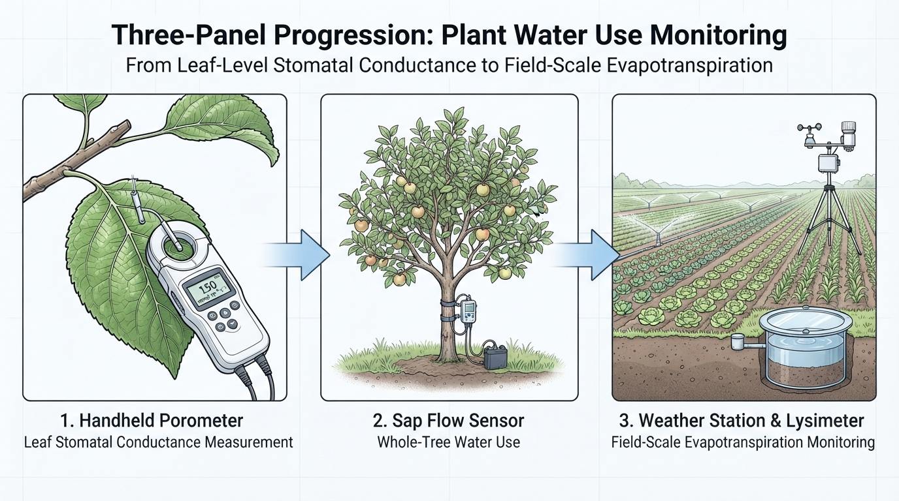
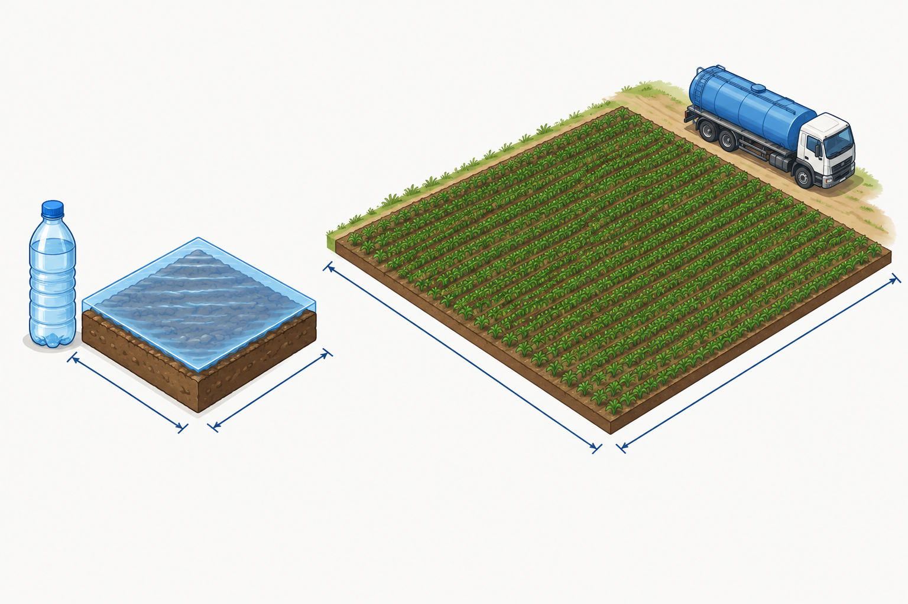
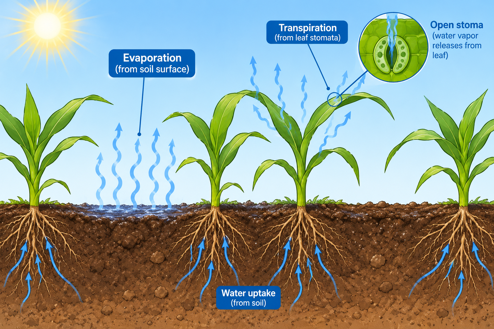
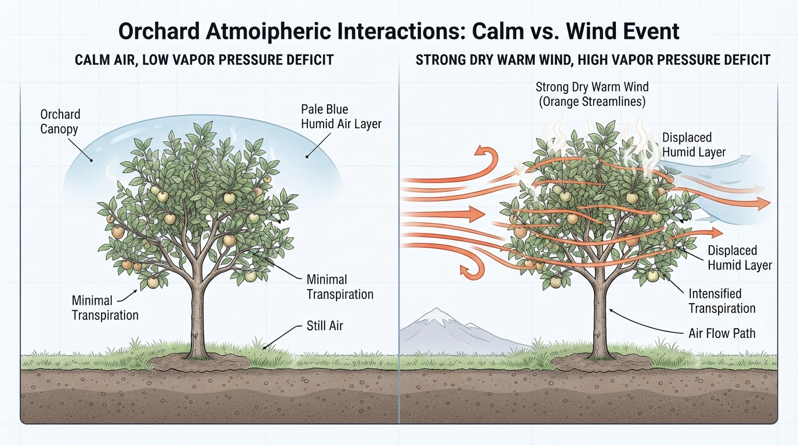
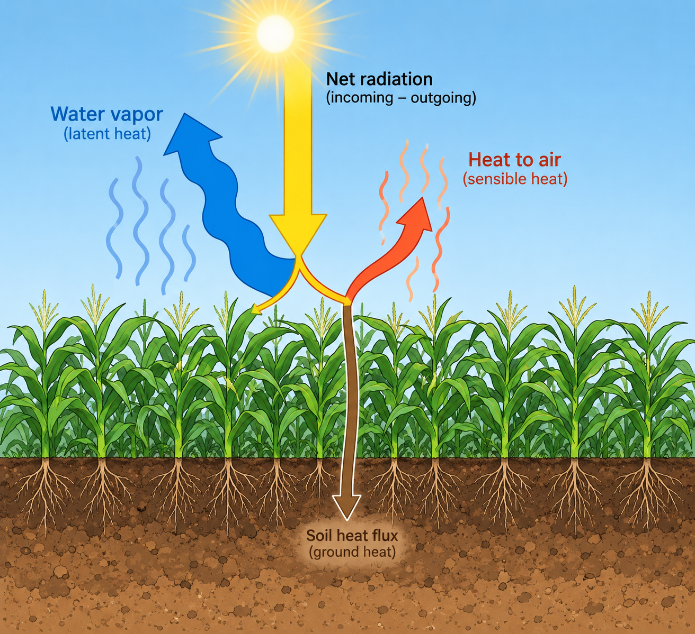
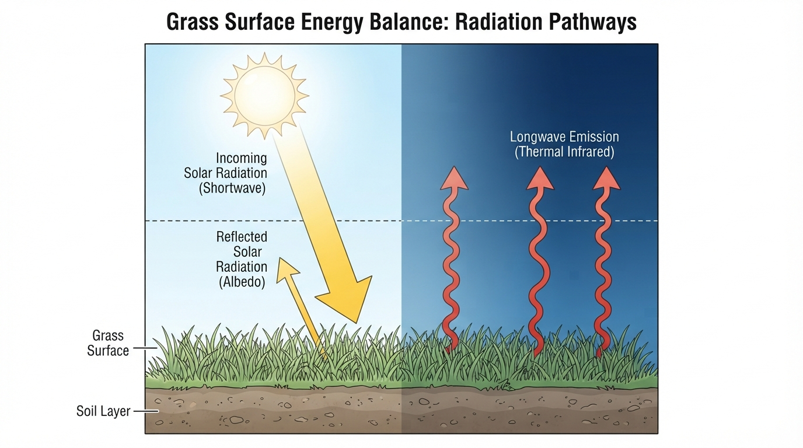
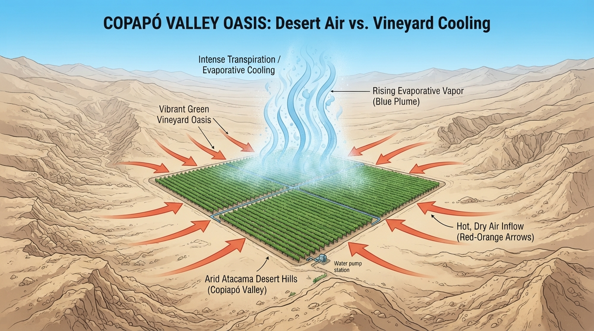

```{r}
#| include: false
source("../_common.R")
```

## ¿Cuántos camiones aljibe "se toma" una hectárea de maíz en un día de enero? {.center background-image="../../images/maiz_camiones_aljibe.png" background-opacity="0.2"}

::: {style="font-size: 0.9em;"}
Zona central, cultivo en plena floración, día despejado. Un camión aljibe carga **10 000 L**.

Piénsalo 30 segundos y anota tu apuesta.
:::

. . .

::: {style="font-size: 1.1em; text-align: center; margin-top: 1em;"}
**≈ 7 camiones aljibe (~70 000 L) por hectárea, cada día**
:::

. . .

::: {style="font-size: 0.9em; text-align: center;"}
Eso equivale a una lámina de **7 mm/día**. Casi toda esa agua vuelve a la atmósfera como vapor.

**¿De dónde sale ese número y qué lo controla?** Esa es la pregunta de hoy.
:::

::: {.notes}
Recoger 3-4 apuestas en voz alta. Lo normal es que subestimen (1 camión o menos). El número sale de una ETc típica de maíz en enero (~7 mm/día): 7 mm × 10 m³/ha por mm = 70 m³/ha = 70 000 L. La conversión mm → m³/ha la trabajamos en esta misma sesión.
:::

---

## Recapitulación: Unidad 3 {.center}

::: {style="font-size: 0.85em;"}
**Unidad 3 — Ideas fuerza:**  
- El agua sube por el **xilema** tirada por la transpiración (cohesión-tensión)  
- Más del 90% del agua sale por los **estomas**  
- La transpiración depende de la **demanda atmosférica** (radiación, DPV, viento) y del **control estomático** ($g_s$)  
- Para fijar CO₂ la planta **debe** perder agua (WUE)  

**Ahora:** pasamos de la **hoja** al **cultivo**. ¿Cuánta agua pierde una hectárea completa, sumando plantas y suelo?
:::

---

## Información de la sesión {.center}

| | |
|---|---|
| **Unidad** | 4 — Requerimiento hídrico de los cultivos |
| **Sesión** | 4.1 |
| **RAA** | RAA6 |
| **Duración** | ~90 minutos |
| **Contenido** | Requerimiento hídrico, evapotranspiración (E + T), factores que controlan la ET, balance de energía $R_n = G + H + \lambda E$ |

---

## Objetivos de aprendizaje {.center}

Al finalizar esta sesión, serás capaz de:

1. Explicar el concepto de **requerimiento hídrico** de un cultivo
2. Definir la **evapotranspiración** (ET) como la suma de evaporación y transpiración
3. Convertir láminas de agua (mm) a volúmenes (m³/ha, L)
4. Identificar los factores **climáticos, de cultivo y de manejo** que controlan la ET
5. Interpretar el **balance de energía** de la superficie ($R_n = G + H + \lambda E$) y calcular ET a partir de él

---

## De la hoja al potrero {.center}

::: {style="font-size: 0.9em;"}
En la Unidad 3 medimos el agua en la **hoja** (mmol m⁻² s⁻¹). Para regar necesitamos el agua del **cultivo completo** (mm/día).

| Escala | Qué medimos | Unidad típica | Instrumento |
|--------|-------------|---------------|-------------|
| Hoja | Transpiración ($E$) | mmol H₂O m⁻² s⁻¹ | Porómetro, IRGA |
| Planta | Flujo de savia | L/planta/día | Sensor de flujo de savia |
| **Cultivo** | **Evapotranspiración (ET)** | **mm/día** | **Estación meteorológica, lisímetro** |

::: {style="margin-top: 0.8em; font-weight: bold; text-align: center;"}
El agricultor no riega hojas: riega hectáreas. Por eso trabajamos en mm/día.
:::

:::

---

## Medir el agua a distintas escalas {.center}

{fig-align="center" height="540"}

::: {.notes}
Recorrer de izquierda a derecha: porómetro en la hoja (U3), sensor de flujo de savia en el tronco (litros por planta) y, a escala de cultivo, la estación meteorológica y el lisímetro (mm/día). El lisímetro es un tanque de suelo con cultivo que se pesa: la pérdida de peso es la ET. Es el método de referencia con que se calibraron las ecuaciones de FAO-56.
:::

---

## ¿Qué es el requerimiento hídrico? {.center}

::: {style="font-size: 0.9em;"}
El **requerimiento hídrico** de un cultivo es la cantidad de agua que necesita para **compensar lo que pierde por evapotranspiración** y así crecer y producir sin restricción.

$$ \text{Requerimiento hídrico} \approx ET_c $$

- Depende del **clima** (cuánto "pide" la atmósfera)
- Depende del **cultivo** (especie, cobertura, etapa)
- Se expresa como **lámina de agua**: mm/día, mm/mes, mm/temporada

. . .

::: {style="margin-top: 0.6em; font-size: 0.85em;"}
**Ojo:** requerimiento hídrico ≠ necesidad de riego. Parte del requerimiento lo cubre la lluvia o el agua guardada en el suelo. La **necesidad de riego** es lo que falta (lo veremos en la U5).
:::

:::

::: {.notes}
Insistir en la diferencia: el requerimiento es de la planta (fisiológico-climático), la necesidad de riego es del sistema (requerimiento − aportes de lluvia efectiva y del suelo). En la zona central, en verano, casi todo el requerimiento es necesidad de riego porque no llueve.
:::

---

## ¿Por qué medir el agua en milímetros? {.center .smaller}

::: {style="font-size: 0.9em;"}
Una **lámina** de 1 mm es el agua que cubriría una superficie plana con 1 mm de altura.

$$ 1 \text{ mm} = 1 \text{ L/m}^2 = 10 \text{ m}^3\text{/ha} = 10\,000 \text{ L/ha} $$

:::: {.columns}
::: {.column width="48%"}

:::
::: {.column width="52%"}
| Lámina | Por m² | Por hectárea |
|--------|--------|--------------|
| 1 mm | 1 L | 10 m³ |
| 5 mm | 5 L | 50 m³ |
| **7 mm** | **7 L** | **70 m³ (≈ 7 camiones)** |
| 600 mm (temporada) | 600 L | 6 000 m³ |
:::
::::

::: {style="margin-top: 0.8em; font-size: 0.85em;"}
Ventaja: la lluvia (pluviómetro), la ET (estación) y el agua del suelo (ADT, U2) se expresan **en la misma unidad** y se pueden sumar y restar.
:::

:::

::: {.notes}
Deducción rápida en la pizarra: 1 ha = 10 000 m²; 1 mm = 0.001 m; volumen = 10 000 × 0.001 = 10 m³. Recordar que en U2 calculamos ADT y AFA en mm: ahora vemos por qué esa unidad es tan útil.
:::

---

## Ejercicio rápido: de mm a m³ {.center}

**Problema:** Un huerto de paltos de **4 ha** tiene una ET de **5.5 mm/día** en febrero.

1. ¿Cuántos m³ de agua pierde el huerto en un día?
2. ¿Y en los 28 días de febrero?
3. Si el pozo entrega 20 L/s, ¿cuántas horas al día debe funcionar para reponer esa agua (sin considerar pérdidas)?

::: {style="font-size: 0.8em; text-align: center; margin-top: 1em;"}
Resuelve en 4 minutos.
:::

::: {.notes}
1. 5.5 mm × 10 m³/ha/mm × 4 ha = 220 m³/día. 2. 220 × 28 = 6 160 m³. 3. 20 L/s = 72 m³/h → 220 / 72 ≈ 3.1 h/día. La pregunta 3 adelanta la lógica del tiempo de riego (U5); las pérdidas por eficiencia se agregan allá.
:::

---

## Evapotranspiración: dos procesos en uno {.center .smaller}

::: {style="font-size: 0.9em;"}
La **evapotranspiración (ET)** es la pérdida total de agua desde una superficie cultivada hacia la atmósfera:

$$ ET = E + T $$

:::: {.columns}
::: {.column width="50%"}

:::
::: {.column width="50%"}
| | ¿Desde dónde sale? | ¿Quién la controla? |
|---|---|---|
| **Evaporación ($E$)** | Superficie del suelo y agua sobre las hojas | Humedad del suelo superficial, sombra |
| **Transpiración ($T$)** | Interior de la hoja, por los estomas | Planta (estomas, $g_s$) + atmósfera |
:::
::::

::: {style="margin-top: 0.8em; font-weight: bold; text-align: center;"}
Se agrupan porque ocurren al mismo tiempo y es muy difícil medirlas por separado.
:::

:::

::: {.notes}
Notación: en esta unidad E es evaporación del suelo y T transpiración. En la U3 usamos E para la transpiración de la hoja; aclarar el cambio para evitar confusión.
:::

---

## ¿Quién domina: el suelo o la planta? {.center}

```{r}
#| fig-width: 9
#| fig-height: 4.3
#| fig-align: center
temp <- tibble(dia = 0:120) |>
  mutate(cobertura = 0.9 / (1 + exp(-(dia - 45) / 9)) + 0.03,
         T = 6.5 * cobertura,
         E = 3.2 * exp(-dia / 30) * (1 - cobertura) + 0.4 * (1 - cobertura)) |>
  select(dia, E, T) |>
  pivot_longer(-dia) |>
  mutate(name = factor(name, levels = c("E", "T"),
                       labels = c("Evaporación del suelo (E)", "Transpiración (T)")))
f_et <- ggplot(temp, aes(dia, value, fill = name)) +
  geom_area(alpha = 0.9) +
  scale_fill_manual(values = c(col_serie[2], col_serie[3])) +
  annotate("text", x = 12, y = 5.8, label = "Suelo desnudo:\ndomina E", hjust = 0, size = 5, colour = col_texto) +
  annotate("text", x = 85, y = 7.4, label = "Cobertura completa:\n> 90% es T", hjust = 0, size = 5, colour = col_texto) +
  scale_y_continuous(limits = c(0, 8.2)) +
  labs(x = "Días desde la siembra", y = "ET (mm/día)",
       caption = "Curvas ilustrativas de un cultivo anual (ej. maíz) con suelo húmedo")
f_et
```

::: {style="font-size: 0.8em; text-align: center;"}
Al inicio, casi toda la ET es **evaporación** del suelo. Cuando el follaje cubre el suelo, la **transpiración** domina.
:::

::: {.notes}
Pregunta para la sala: si el agua que se evapora del suelo no la usa la planta, ¿cómo podemos reducirla? Respuestas esperadas: mulch, riego por goteo (moja menos superficie), riego subsuperficial, regar de noche. Esta curva es la base del Kc variable que veremos en la sesión 4.2.
:::

---

## Evaporar agua cuesta energía {.center .smaller}

::: {style="font-size: 0.9em;"}
Para pasar agua líquida a vapor hay que romper los **puentes de hidrógeno** (U1). Esa energía es el **calor latente de vaporización** ($\lambda$):

$$ \lambda \approx 2.45 \text{ MJ/kg} \quad (\text{a } 20\,°\text{C}) $$

Como 1 mm de lámina = 1 kg de agua por m²:

$$ \text{Evaporar 1 mm} = 2.45 \text{ MJ/m}^2 $$

. . .

**¿Cuánta energía llega?** Un día despejado de enero en Santiago: $R_s \approx 28$ MJ/m²/día.

$$ \frac{28}{2.45} \approx 11 \text{ mm/día} \quad \text{(máximo teórico si toda la energía evaporara agua)} $$

::: {style="margin-top: 0.6em; font-weight: bold; text-align: center;"}
En la práctica la ET de enero es ~6-7 mm/día: parte de la energía se refleja o calienta el aire y el suelo.
:::

:::

::: {.notes}
Esta es la idea central de la sesión: la ET está limitada por la energía disponible. Conectar con la U1 (alto calor latente del agua por los puentes de hidrógeno) y con la U3 (la transpiración enfría la hoja porque consume esa energía). El "techo" de 11 mm explica por qué nunca vemos ET de 20 mm/día en un cultivo regado normal.
:::

---

## Factores que controlan la ET {.center}

::: {style="font-size: 0.85em;"}
| Grupo | Factores | Qué aportan |
|-------|----------|-------------|
| **Clima** | Radiación, temperatura, humedad del aire (DPV), viento | **Energía** y **capacidad del aire** para llevarse el vapor |
| **Cultivo** | Especie, altura, cobertura, etapa fenológica, control estomático | **Superficie** que transpira y su resistencia |
| **Suelo y manejo** | Humedad del suelo, salinidad, fertilidad, plagas, método de riego, mulch | Si hay **agua disponible** para responder a la demanda |

::: {style="margin-top: 0.8em; font-weight: bold; text-align: center;"}
El clima fija la demanda; el cultivo y el suelo deciden cuánto de esa demanda se cumple.
:::

:::

---

## Radiación: la fuente de energía {.center}

::: {style="font-size: 0.9em;"}
La **radiación solar** es el factor más importante: sin energía no hay evaporación.

| Situación | $R_s$ (MJ/m²/día) | ETo aprox. (mm/día) |
|-----------|-------------------|---------------------|
| Invierno nublado, zona central | 5-8 | 0.5-1.5 |
| Primavera despejada | 18-22 | 3-5 |
| **Verano despejado** | **26-30** | **6-8** |

- La radiación depende de la **latitud**, la **época del año** y la **nubosidad**
- Por eso la ET de la zona norte es mayor que la del sur, y la de enero mayor que la de julio

:::

::: {.notes}
Valores orientativos para Chile central. Preguntar: ¿por qué un día nublado de verano tiene menos ET que uno despejado, aunque haga calor? Porque llega menos energía.
:::

---

## Temperatura y humedad: la "sed" del aire {.center}

```{r}
#| fig-width: 9
#| fig-height: 3.8
#| fig-align: center
es_fun <- function(T) 0.6108 * exp(17.27 * T / (T + 237.3))
curva_es <- tibble(T = seq(0, 40, 0.5), es = es_fun(T))
pts <- tibble(T = c(15, 30), es = es_fun(c(15, 30)))
ggplot(curva_es, aes(T, es)) +
  geom_line(colour = col_serie[1], linewidth = 1.2) +
  geom_point(data = pts, colour = col_serie[1], size = 3.5) +
  geom_text(data = pts, aes(label = paste0(round(es, 2), " kPa")),
            hjust = 1.2, vjust = -0.4, size = 5.5, colour = col_texto) +
  labs(x = "Temperatura del aire (°C)", y = "Presión de vapor de\nsaturación eₛ (kPa)")
```

::: {style="font-size: 0.85em;"}
$$ DPV = e_s - e_a = e_s \left(1 - \frac{HR}{100}\right) $$

Al pasar de 15 °C a 30 °C, el aire puede contener **más del doble** de vapor. Con calor y baja humedad, el DPV se dispara y la ET aumenta.
:::

::: {.notes}
Retomar el DPV de la U3. Ejemplo rápido: a 30 °C y HR = 30%, DPV = 4.24 × 0.7 ≈ 3.0 kPa. A 15 °C y HR = 80%, DPV = 1.71 × 0.2 ≈ 0.34 kPa: casi 9 veces menor. La ecuación de eₛ es la misma que usaremos en Penman-Monteith (sesión 4.2).
:::

---

## Viento: el que se lleva el vapor {.center}

::: {style="font-size: 0.9em;"}
Sobre el cultivo se forma una capa de aire **húmedo**. Si nadie la remueve, el aire se satura y la ET baja.

:::: {.columns}
::: {.column width="50%"}
::: {style="font-size: 0.9em;"}
- El **viento** reemplaza el aire húmedo por aire más seco → mantiene alto el gradiente de vapor
- El efecto del viento es **mayor cuando el aire es seco**: viento + aire seco = "secador de pelo"
- Con aire húmedo (costa, neblina), el viento aumenta poco la ET
:::
:::
::: {.column width="50%"}

:::
::::

::: {style="margin-top: 0.8em; font-size: 0.85em;"}
**Ejemplo chileno:** los vientos **puelche** y **terral** (secos y cálidos, bajan de la cordillera) pueden elevar la ET de un día de forma notable y causar estrés en cultivos que estaban bien regados.
:::

:::

---

## Cultivo y suelo: cuánto de la demanda se cumple {.center .smaller}

::: {style="font-size: 0.9em;"}
Bajo el **mismo clima**, dos superficies pueden evapotranspirar muy distinto:

| Factor | Más ET | Menos ET |
|--------|--------|----------|
| Cobertura | Follaje denso, cubre el suelo | Plantación joven, suelo desnudo seco |
| Altura y rugosidad | Cultivo alto (maíz, frutales) | Cultivo bajo y liso |
| Etapa fenológica | Floración, llenado | Establecimiento, senescencia |
| Estomas | Abiertos ($g_s$ alta) | Cerrados por estrés o salinidad |
| **Agua en el suelo** | **Sobre el umbral de riego** | **Bajo el umbral (estrés)** |

:::

::: {.notes}
La altura y la rugosidad importan porque un cultivo alto "atrapa" más turbulencia y el viento remueve mejor el vapor. Este es el origen físico de que Kc > 1 en maíz o caña en plena cobertura (sesión 4.2).
:::

---

## Cuando el suelo se seca, la ET cae {.center}

```{r}
#| fig-width: 9
#| fig-height: 4.2
#| fig-align: center
p <- 0.5
ks <- tibble(agot = seq(0, 100, 1)) |>
  mutate(Ks = ifelse(agot <= p * 100, 1, (100 - agot) / (100 - p * 100)))
ggplot(ks, aes(agot, Ks)) +
  annotate("rect", xmin = 0, xmax = 50, ymin = -Inf, ymax = Inf, fill = col_agua[2], alpha = 0.5) +
  annotate("rect", xmin = 50, xmax = 100, ymin = -Inf, ymax = Inf, fill = "#e6e5e1", alpha = 0.6) +
  geom_line(colour = col_serie[1], linewidth = 1.3) +
  annotate("text", x = 25, y = 0.35, label = "AFA\nET = ET máxima", size = 5.2, colour = col_texto) +
  annotate("text", x = 75, y = 0.85, label = "Reserva (ADT − AFA)\nET real < ET máxima", size = 5.2, colour = col_texto) +
  scale_x_continuous(breaks = c(0, 50, 100), labels = c("0%\n(CC)", "50%\n(umbral, p = 0.5)", "100%\n(PMP)")) +
  scale_y_continuous(breaks = c(0, 0.5, 1)) +
  labs(x = "Agotamiento del agua disponible (ADT)", y = "ET real / ET máxima")
```

::: {style="font-size: 0.8em; text-align: center;"}
Mientras el cultivo consume la **AFA** (U2), transpira a tasa máxima. Al entrar en la reserva, cierra estomas (U3) y la **ET real** cae.
:::

::: {.notes}
Esta figura une las tres unidades: el umbral de riego de la U2 (θ_umbral = CC − AFA), el cierre estomático de la U3 y la ET de la U4. El cociente ET real / ET máxima es lo que FAO-56 llama coeficiente de estrés Ks; solo mencionarlo, se trabaja en U5.
:::

---

## Tú eres el agrónomo: ¿qué día evapotranspira más? {.center}

::: {style="font-size: 0.85em;"}
Mismo huerto de vid, bien regado, en plena temporada. Ordena los días de **mayor a menor ET**:

| Día | Cielo | T (°C) | HR (%) | Viento |
|-----|-------|--------|--------|--------|
| **A** | Nublado | 18 | 80 | Calmo |
| **B** | Despejado | 30 | 30 | Calmo |
| **C** | Despejado | 30 | 30 | Puelche fuerte |
| **D** | Despejado | 22 | 75 | Brisa costera |

[→ **C > B > D > A**. C y B tienen la misma energía y DPV, pero en C el viento seco remueve el vapor. D tiene energía pero aire húmedo. A tiene poca energía y aire casi saturado.]{.fragment}
:::

::: {.notes}
~5 minutos en parejas. Pedir que justifiquen cada posición con un factor de la tabla de factores. Discusión típica: B vs D (misma radiación, distinto DPV). Si hay tiempo, preguntar en qué día un cultivo con poca agua en el suelo sufriría más estrés (C).
:::

---

## Balance de energía en la superficie {.center}

::: {style="font-size: 0.9em;"}
La energía que entra a la superficie de un cultivo **se reparte** en tres destinos:

$$ R_n = G + H + \lambda E $$

:::: {.columns}
::: {.column width="40%"}
{height="290"}
:::
::: {.column width="60%"}
::: {style="font-size: 0.85em;"}
| Término | Nombre | ¿A dónde va la energía? |
|---------|--------|--------------------------|
| $R_n$ | Radiación neta | Energía disponible (entra − sale) |
| $G$ | Flujo de calor del suelo | Calienta el suelo |
| $H$ | Calor sensible | Calienta el aire |
| $\lambda E$ | **Calor latente** | **Evapora agua (ET)** |
:::
:::
::::

::: {style="margin-top: 0.8em; font-weight: bold; text-align: center;"}
Si conocemos $R_n$, $G$ y $H$, la ET es "lo que sobra": $\lambda E = R_n - G - H$.
:::

:::

::: {.notes}
Analogía: el sueldo mensual (Rn) se reparte en arriendo (G), comida (H) y ahorro (λE). Si sabemos cuánto entra y cuánto se gastó en lo demás, sabemos cuánto se ahorró. Este es el principio de varios métodos de medición de ET (razón de Bowen, satélites con METRIC/SEBAL, U6).
:::

---

## ¿Qué pasa con la radiación que llega? {.center}

{fig-align="center" height="540"}

::: {.notes}
Antes de la ecuación: de la radiación solar que llega (onda corta), una parte se refleja (albedo) y el resto se absorbe. Al mismo tiempo, la superficie emite calor hacia el cielo como onda larga (infrarrojo), sobre todo con cielo despejado. Lo que queda es la radiación neta, la energía que realmente se puede repartir entre G, H y λE.
:::

---

## Radiación neta: la energía disponible {.center .smaller}

::: {style="font-size: 0.9em;"}
No toda la radiación solar ($R_s$) queda en la superficie:

$$ R_n = \underbrace{(1 - \alpha)\, R_s}_{R_{ns}\text{: onda corta absorbida}} - \underbrace{R_{nl}}_{\text{onda larga perdida}} $$

| Término | Significado | Valor típico |
|---------|-------------|--------------|
| $\alpha$ | **Albedo**: fracción de $R_s$ reflejada | 0.23 (pasto de referencia) |
| $R_{ns}$ | Onda corta absorbida | ~77% de $R_s$ |
| $R_{nl}$ | Pérdida neta de calor (onda larga) hacia el cielo | 3-8 MJ/m²/día |

**Ejemplo (enero, Santiago):** $R_s = 28$ MJ/m²/día, $R_{nl} = 5$ MJ/m²/día

$$ R_n = (1 - 0.23) \times 28 - 5 = 21.6 - 5 = 16.6 \text{ MJ/m}^2\text{/día} $$

:::

::: {.notes}
Albedos orientativos: suelo oscuro húmedo ~0.10, pasto 0.23, suelo claro seco ~0.30-0.35, nieve > 0.8. Rnl es mayor con cielo despejado y aire seco (la superficie "ve" un cielo frío). El cálculo detallado de Rnl se hace en el Taller 4 con la ecuación FAO-56.
:::

---

## ¿Cómo se reparte la energía en un día? {.center}

```{r}
#| fig-width: 9.5
#| fig-height: 4.6
#| fig-align: center
hora <- seq(5, 21, 0.5)
rn <- pmax(620 * sin(pi * (hora - 6.5) / 13), 0) - 40
reparto <- bind_rows(
  tibble(hora, caso = "Cultivo bien regado", Rn = rn,
         LE = ifelse(rn > 0, 0.78 * rn, 0.2 * rn), G = ifelse(rn > 0, 0.08 * rn, 0.6 * rn)),
  tibble(hora, caso = "Cultivo con estrés hídrico", Rn = rn,
         LE = ifelse(rn > 0, 0.22 * rn, 0.1 * rn), G = ifelse(rn > 0, 0.12 * rn, 0.6 * rn))
) |>
  mutate(H = Rn - LE - G) |>
  pivot_longer(c(Rn, LE, H, G)) |>
  mutate(name = factor(name, levels = c("Rn", "LE", "H", "G"),
                       labels = c("Rn", "λE (ET)", "H (calienta el aire)", "G (calienta el suelo)")))
ggplot(reparto, aes(hora, value, colour = name, linetype = name)) +
  geom_hline(yintercept = 0, colour = col_ref, linewidth = 0.4) +
  geom_line(linewidth = 1.2) +
  facet_wrap(~caso) +
  scale_colour_manual(values = c(col_texto, col_serie[1], col_serie[2], col_serie[3])) +
  scale_linetype_manual(values = c("dashed", "solid", "solid", "solid")) +
  scale_x_continuous(breaks = c(6, 12, 18), labels = c("06:00", "12:00", "18:00")) +
  labs(x = NULL, y = "Flujo de energía (W/m²)",
       caption = "Curvas ilustrativas para un día despejado de verano")
```

::: {style="font-size: 0.8em; text-align: center;"}
Con agua, la mayor parte de $R_n$ se usa en **evaporar** ($\lambda E$). Con estrés, los estomas cierran y la energía **calienta el aire** ($H$): el cultivo se "calienta".
:::

::: {.notes}
Pregunta antes de mostrar los paneles: si cierro los estomas, ¿a dónde se va la energía que ya no evapora agua? Respuesta: a H (y un poco a G); la hoja y el aire se calientan. Es exactamente lo que vimos en la U3 (hoja estresada 2-5 °C más caliente) y lo que mide la termografía en la U6. Unidades: W/m² = J/s/m²; a escala diaria se trabaja en MJ/m²/día.
:::

---

## Razón de Bowen: ¿la superficie calienta o evapora? {.center .smaller}

::: {style="font-size: 0.9em;"}
La **razón de Bowen** ($\beta$) compara el calor que se va en calentar el aire con el que se va en evaporar:

$$ \beta = \frac{H}{\lambda E} $$

| Superficie | $\beta$ aprox. | Interpretación |
|------------|----------------|----------------|
| Cultivo bien regado, pradera verde | 0.1-0.3 | Casi toda la energía evapora agua |
| Pradera de secano en verano | 1-3 | Reparto similar o domina $H$ |
| Desierto | > 5 | Casi no hay agua que evaporar |
| **Oasis regado en zona árida** | **< 0** | **$H$ negativo: el aire caliente aporta energía extra** |

:::

::: {.notes}
β < 0 es el "efecto oasis" o advección: un huerto regado rodeado de desierto (valle de Copiapó, Pica) recibe aire caliente y seco que entrega energía al cultivo. Resultado: λE > Rn y la ET puede superar lo que permitiría solo la radiación. Por eso los primeros lotes regados en el borde de un valle seco consumen más agua.
:::

---

## El efecto oasis: cuando $\lambda E > R_n$ {.center}

{fig-align="center" height="440"}

::: {style="font-size: 0.8em; text-align: center;"}
El aire caliente y seco del desierto entrega energía al huerto regado: $H < 0$, $\beta < 0$ y la ET supera lo que permitiría solo la radiación.
:::

::: {.notes}
Ejemplos en Chile: valle de Copiapó, oasis de Pica, valle de Elqui. Pregunta para la sala: ¿qué huerto consume más agua por hectárea, uno en el centro del valle o uno en el borde, junto al cerro seco? Respuesta: el del borde, porque recibe más aire seco y caliente (advección). Esta es la base de la pregunta 7 de autoevaluación.
:::

---

## Ejercicio: de energía a milímetros {.center}

**Problema:** En un día de enero, sobre un cultivo de tomate bien regado, una estación de balance de energía registra:

- $R_n = 16.6$ MJ/m²/día
- $G \approx 0$ MJ/m²/día (a escala diaria)
- $H = 3.4$ MJ/m²/día

1. Calcula $\lambda E$.
2. Convierte $\lambda E$ a ET en mm/día ($\lambda = 2.45$ MJ/kg).
3. ¿Cuántos m³ necesita reponer una parcela de 2.5 ha?
4. Calcula la razón de Bowen. ¿Es coherente con un cultivo bien regado?

::: {style="font-size: 0.8em; text-align: center; margin-top: 1em;"}
Resuelve en 5 minutos.
:::

::: {.notes}
1. λE = 16.6 − 0 − 3.4 = 13.2 MJ/m²/día. 2. ET = 13.2 / 2.45 ≈ 5.4 mm/día. 3. 5.4 × 10 × 2.5 = 135 m³. 4. β = 3.4 / 13.2 ≈ 0.26: sí, coherente (0.1-0.3). G ≈ 0 a escala diaria porque lo que el suelo gana de día lo devuelve de noche; esta simplificación es la misma de FAO-56.
:::

---

## ¿ET de qué? Un adelanto {.center .smaller}

::: {style="font-size: 0.9em;"}
Para comparar climas y cultivos necesitamos un **punto de referencia**:

| Término | ¿Qué es? | Sesión |
|---------|----------|--------|
| **ETo** | ET de un **pasto de referencia** bien regado: solo depende del clima | 4.2 |
| **ETc** | ET de un cultivo específico sin restricciones: $ET_c = K_c \times ET_o$ | 4.2 |
| **ET real** | ET que ocurre de verdad (puede ser menor por estrés, plagas, salinidad) | 4.2 / U5 |

::: {style="margin-top: 0.8em; font-weight: bold; text-align: center;"}
ETo = demanda del clima · Kc = efecto del cultivo · ET real = lo que realmente pasa en el campo
:::

:::

::: {.notes}
Solo presentar la idea; el cálculo de ETo (Penman-Monteith, Hargreaves) y la curva de Kc son el tema de la sesión 4.2. Conectar con la figura de Ks: ET real = Ks × Kc × ETo.
:::

---

## Ejercicio integrador {.center}

**Situación:** Dos huertos de nogal, a 5 km de distancia, en el mismo día de enero ($R_s$ = 28 MJ/m²/día):

- **Huerto 1:** riego al día, suelo sobre el umbral, follaje denso.
- **Huerto 2:** el pozo falló hace 10 días; el suelo está bajo el umbral de riego.

1. ¿Cuál tiene mayor $\lambda E$? ¿Y mayor $H$? Explica con el balance de energía.
2. Si midieras la temperatura de las hojas al mediodía, ¿qué esperarías encontrar?
3. Si el Huerto 1 tiene ET = 6.5 mm/día y 12 ha, ¿cuántos camiones aljibe "consume" por día?

::: {style="font-size: 0.8em; text-align: center; margin-top: 1em;"}
Resuelve en 5 minutos.
:::

::: {.notes}
1. Mismo Rn aprox. Huerto 1: λE alto, H bajo. Huerto 2: estomas cerrados (U3) → λE bajo → H alto. 2. Hojas del Huerto 2 más calientes que el aire (2-5 °C); las del Huerto 1 más frías (transpiración enfría). 3. 6.5 × 10 × 12 = 780 m³/día = 78 camiones de 10 m³.
:::

---

## Vocabulario clave {.center .smaller}

| Término | Definición |
|---------|-----------|
| Requerimiento hídrico | Agua que necesita el cultivo para compensar su ET sin restricción |
| Lámina de agua | Altura de agua sobre una superficie (1 mm = 1 L/m² = 10 m³/ha) |
| Evapotranspiración (ET) | Evaporación del suelo + transpiración del cultivo |
| Calor latente ($\lambda$) | Energía para evaporar el agua: 2.45 MJ/kg |
| Radiación neta ($R_n$) | Energía disponible en la superficie (entra − sale) |
| Albedo ($\alpha$) | Fracción de radiación solar reflejada (0.23 en pasto) |
| Calor sensible ($H$) | Energía que calienta el aire |
| Flujo de calor del suelo ($G$) | Energía que calienta el suelo |
| Razón de Bowen ($\beta$) | $H / \lambda E$: indica si la superficie calienta o evapora |

---

## Resumen de conceptos clave {.center .smaller}

1. El **requerimiento hídrico** es el agua que el cultivo pierde por **ET**; la necesidad de riego es lo que falta tras la lluvia y el suelo

2. **ET = E + T**: al inicio domina la evaporación del suelo; con cobertura completa, la transpiración

3. Trabajamos en **mm**: 1 mm = 1 L/m² = 10 m³/ha

4. Evaporar 1 mm cuesta **2.45 MJ/m²**: la ET está limitada por la **energía** disponible

5. El **clima** fija la demanda (radiación, DPV, viento); el **cultivo y el suelo** deciden cuánto se cumple

6. **Balance de energía:** $R_n = G + H + \lambda E$. Sin agua, la energía calienta el aire ($H$) en vez de evaporar

---

## Para la próxima sesión {.center}

**Sesión 4.2 — Evapotranspiración de referencia y de cultivo**

→ ¿Cómo se calcula la ETo con datos de una estación meteorológica?  
→ Método **Penman-Monteith FAO-56** (completo) y **Hargreaves-Samani** (pocos datos).  
→ Evapotranspiración de cultivo: $ET_c = K_c \times ET_o$ y la curva de $K_c$.  

**Para preparar:** busca en **redmeteo.cl** la estación más cercana a tu casa y anota la temperatura máxima, mínima y humedad relativa de ayer.

---

## Preguntas de autoevaluación {.center .smaller}

1. ¿Cuál es la diferencia entre requerimiento hídrico y necesidad de riego?

2. ¿Qué componentes forman la ET y cómo cambia su importancia relativa durante la temporada de un cultivo anual?

3. Un cultivo tiene ET = 4.8 mm/día. ¿Cuántos litros pierde por m² y cuántos m³ por hectárea en una semana?

4. ¿Por qué la ET de un cultivo regado en enero rara vez supera los 10-11 mm/día en la zona central?

5. Ordene de mayor a menor efecto sobre la ET: viento con aire húmedo, viento con aire seco, día nublado. Justifique.

6. Escriba el balance de energía de la superficie y explique qué le pasa a cada término cuando un cultivo sufre estrés hídrico.

7. Un huerto regado en el valle de Copiapó tiene $\lambda E$ mayor que $R_n$. ¿Cómo es posible? ¿Qué signo tiene $H$?
